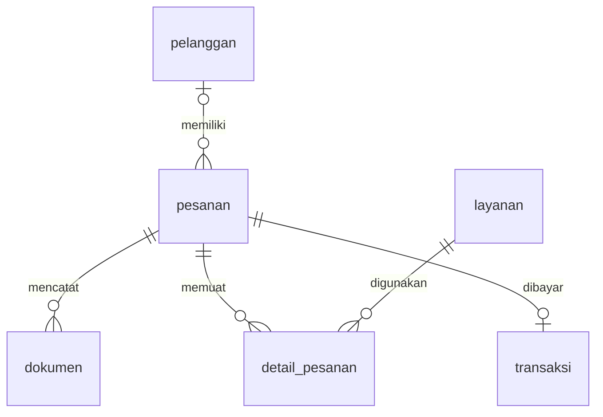

# Sistem Informasi Fotocopy IJA

Aplikasi web untuk membantu operasional usaha **Fotocopy IJA**, mulai dari pencatatan pelanggan dan pesanan, pengelolaan layanan, pembayaran, hingga laporan pendapatan. Dibangun menggunakan **PHP native** dan **MySQL**, dengan halaman yang dipisahkan secara modular.

## Daftar Isi

- [Fitur](#fitur)
- [Hak Akses](#hak-akses)
- [Teknologi dan Kebutuhan](#teknologi-dan-kebutuhan)
- [Instalasi](#instalasi)
- [Akun Demo](#akun-demo)
- [Alur Penggunaan](#alur-penggunaan)
- [Struktur Proyek](#struktur-proyek)
- [Database](#database)
- [Catatan Implementasi](#catatan-implementasi)
- [Pemecahan Masalah](#pemecahan-masalah)
- [Dokumentasi](#dokumentasi)
- [Lisensi](#lisensi)

## Fitur

- **Login dan pengaturan akun:** autentikasi berbasis sesi, logout, dan penggantian kata sandi.
- **Dashboard pemilik:** ringkasan pendapatan, jumlah pesanan, transaksi dibayar, pesanan belum selesai, grafik pendapatan, dan layanan terpopuler.
- **Dashboard pegawai:** ringkasan status dan daftar antrean pesanan.
- **Pelanggan:** menambahkan pelanggan serta mencatat nama dan nomor HP.
- **Katalog layanan:** melihat layanan dan tarif; pemilik dapat menambah, mengubah, dan menghapus layanan sesuai ketentuan relasi database.
- **Pesanan:** memilih pelanggan, mencatat jenis dan kondisi dokumen, memilih beberapa layanan, memasukkan kuantitas dan catatan, serta menghitung total biaya.
- **Pencarian pesanan:** mencari berdasarkan nama pelanggan atau ID pesanan dan memfilter status pengerjaan.
- **Status pengerjaan:** `menunggu`, `diproses`, dan `selesai`.
- **Pembayaran:** mencatat uang yang diterima, menghitung kembalian, dan menampilkan riwayat pembayaran.
- **Cetak nota dan laporan:** melalui dialog cetak browser, termasuk opsi simpan PDF apabila tersedia.
- **Laporan pemilik:** transaksi dan grafik pendapatan berdasarkan periode tanggal pembayaran, serta rekap unit layanan dari seluruh periode.

## Hak Akses

| Fitur | Pemilik / Admin | Pegawai |
| --- | :---: | :---: |
| Dashboard | Ringkasan bisnis dan grafik | Ringkasan operasional |
| Melihat katalog layanan | Ya | Ya |
| Menambah, mengubah, dan menghapus layanan | Ya | Tidak |
| Melihat dan menambah pelanggan | Ya | Ya |
| Membuat dan melihat pesanan | Ya | Ya |
| Memperbarui status pesanan | Ya | Ya |
| Mencatat dan melihat pembayaran | Ya | Ya |
| Mencetak nota pesanan | Ya | Ya |
| Mengakses dan mencetak laporan | Ya | Tidak |
| Mengganti kata sandi sendiri | Ya | Ya |

Istilah **admin** pada antarmuka merujuk pada akun dengan nilai role `pemilik` di database.

## Teknologi dan Kebutuhan

| Komponen | Keterangan |
| --- | --- |
| Backend | PHP native, minimal PHP 8.1 karena menggunakan tipe kembalian `never` |
| Database | MySQL dengan tabel InnoDB dan karakter `utf8mb4` |
| Ekstensi PHP | `PDO`, `pdo_mysql`, dan `mbstring` |
| Frontend | HTML, CSS, dan JavaScript |
| Grafik | Chart.js 4.4.7 melalui CDN jsDelivr |
| Server lokal | Laragon, XAMPP, atau server bawaan PHP untuk pengembangan |
| Zona waktu | `Asia/Jakarta` |

Tidak diperlukan instalasi dependensi melalui Composer atau npm. Koneksi internet diperlukan untuk memuat Chart.js dari CDN; jika CDN tidak tersedia, grafik tidak ditampilkan.

## Instalasi

### 1. Siapkan folder proyek

Unduh atau clone repository ini, lalu letakkan seluruh isinya di folder aplikasi pada document root server lokal. Contoh:

- Laragon: `C:\laragon\www\si-fotocopy-ija-modular`
- XAMPP: `C:\xampp\htdocs\si-fotocopy-ija-modular`

Pastikan `index.php`, `config.php`, `install.php`, dan `database.sql` berada langsung di dalam folder tersebut.

### 2. Jalankan server

Aktifkan web server dan MySQL melalui Laragon atau XAMPP. Pastikan versi PHP minimal 8.1 dan ekstensi yang dibutuhkan sudah aktif.

### 3. Atur koneksi database

Edit konstanta koneksi pada `config.php` sesuai lingkungan lokal. Contoh berikut adalah **template**, bukan kredensial bawaan proyek:

```php
const DB_HOST = '127.0.0.1';
const DB_PORT = '3306';
const DB_NAME = 'si_fotocopy_ija';
const DB_USER = 'root';
const DB_PASS = 'kata_sandi_mysql_anda';
```

Jika akun MySQL lokal tidak memiliki kata sandi, gunakan string kosong untuk `DB_PASS`.

> Pertahankan nama database `si_fotocopy_ija` untuk instalasi standar. Nama tersebut juga ditulis langsung di `install.php` dan `database.sql`; mengganti `DB_NAME` saja tidak cukup.

### 4. Pasang database dan data contoh

Buka [halaman instalasi lokal](http://localhost/si-fotocopy-ija-modular/install.php), lalu klik **Pasang database + data dummy**.

Installer akan membuat tujuh tabel. Jika tabel `users` masih kosong, installer juga menambahkan:

- Dua akun demo: pemilik dan pegawai.
- Enam layanan contoh.
- Lima pelanggan contoh.
- Sebanyak 31 pesanan beserta detail dokumen, layanan, dan pembayaran contoh untuk pesanan yang dibayar.

Gunakan database baru untuk percobaan pertama. Akun MySQL yang digunakan installer perlu memiliki izin membuat database dan tabel, serta memasukkan data. Jika tabel `users` sudah berisi akun, installer melewati penambahan data contoh.

> Mengimpor `database.sql` saja hanya membuat struktur database; file tersebut tidak menambahkan akun login maupun data contoh.

### 5. Masuk ke aplikasi

Buka [halaman login lokal](http://localhost/si-fotocopy-ija-modular/login.php), lalu gunakan salah satu akun demo di bawah.

Setelah instalasi berhasil, hapus `install.php` dari direktori yang dilayani web server dan ganti kata sandi kedua akun melalui **Pengaturan Akun**.

Kemudian buka [installer](http://127.0.0.1:8000/install.php), atau [halaman login](http://127.0.0.1:8000/login.php) jika instalasi sudah selesai. Server bawaan PHP digunakan untuk pengembangan lokal.

## Akun Demo

| Peran | Username | Kata sandi |
| --- | --- | --- |
| Pemilik / Admin | `admin` | `admin123` |
| Pegawai | `pegawai` | `pegawai123` |

Akun ini dibuat oleh `install.php` ketika tabel `users` masih kosong. Gunakan untuk demonstrasi lokal dan ganti kata sandinya sebelum aplikasi digunakan dengan data nyata.

## Alur Penggunaan

1. Masuk sebagai pemilik atau pegawai.
2. Tambahkan pelanggan melalui menu **Pelanggan**, jika belum terdaftar.
3. Periksa katalog layanan. Pemilik dapat menyesuaikan nama layanan dan tarif.
4. Buka **Pesanan Baru**, pilih pelanggan, isi informasi dokumen, lalu tambahkan layanan dan jumlah unitnya.
5. Simpan pesanan. Sistem menghitung total dan memberi status awal `menunggu`.
6. Perbarui status pengerjaan melalui halaman detail pesanan.
7. Catat pembayaran pada halaman detail dengan nominal minimal sebesar total tagihan. Sistem menghitung kembalian dan otomatis mengubah status menjadi `selesai`.
8. Cetak nota jika diperlukan.
9. Pemilik dapat membuka **Laporan & Grafik**, menentukan periode pembayaran, dan mencetak laporan.

Status pengerjaan dan status pembayaran ditampilkan terpisah. Mengubah status menjadi `selesai` secara manual tidak otomatis mencatat pembayaran.

## Struktur Proyek

| Lokasi | Fungsi |
| --- | --- |
| `index.php` | Router utama dan pemilihan halaman sesuai role |
| `config.php` | Koneksi database, sesi, autentikasi, CSRF, dan fungsi bantuan |
| `install.php` | Pembuatan database dan pengisian data contoh |
| `database.sql` | Definisi tujuh tabel beserta relasinya |
| `login.php`, `logout.php` | Proses masuk dan keluar akun |
| `actions/post.php` | Pemrosesan perubahan data melalui POST |
| `layouts/header.php`, `layouts/footer.php` | Layout bersama dan navigasi |
| `pages/admin/dashboard.php` | Dashboard pemilik |
| `pages/pegawai/dashboard.php` | Dashboard pegawai |
| `pages/buat.php`, `pages/pesanan.php`, `pages/detail.php` | Pembuatan, daftar, dan detail pesanan |
| `pages/pelanggan.php`, `pages/layanan.php` | Pelanggan dan katalog layanan |
| `pages/pembayaran.php`, `pages/laporan.php` | Riwayat pembayaran dan laporan |
| `pages/profil.php` | Informasi akun dan penggantian kata sandi |
| `assets/style.css`, `assets/app.js` | Tampilan, grafik, dan interaksi formulir |
| `Buku Panduan Pengguna.pdf` | Panduan penggunaan aplikasi |

## Database

Database utama: **`si_fotocopy_ija`**.

| Tabel | Isi utama |
| --- | --- |
| `users` | Akun pengguna, hash kata sandi, dan role |
| `pelanggan` | Nama pelanggan dan nomor HP |
| `layanan` | Nama layanan dan tarif saat ini |
| `pesanan` | Pelanggan, tanggal, jumlah dokumen/unit, total, status, dan catatan |
| `dokumen` | Jenis dan kondisi dokumen dalam pesanan |
| `detail_pesanan` | Layanan, jumlah unit, harga satuan, dan subtotal per pesanan |
| `transaksi` | Pembayaran pesanan, uang diterima, dan waktu pembayaran |

Relasi utama:



Tabel `users` menyimpan akun autentikasi secara terpisah dan tidak memiliki foreign key ke tabel operasional.

- Satu pesanan dapat memuat beberapa layanan melalui `detail_pesanan`.
- Pasangan `id_pesanan` dan `id_layanan` menjadi primary key gabungan, sehingga layanan yang sama tidak dapat diulang dalam satu pesanan. Sesuaikan jumlah unit pada baris layanan tersebut.
- Kolom `transaksi.id_pesanan` bersifat unik: satu pesanan hanya memiliki satu catatan pembayaran.
- Layanan yang sudah digunakan dalam detail pesanan tidak dapat dihapus karena relasi `ON DELETE RESTRICT`.
- Harga satuan disimpan dalam detail pesanan, sehingga perubahan tarif katalog tidak mengubah harga transaksi sebelumnya.

## Catatan Implementasi

- Kata sandi disimpan menggunakan `password_hash()` dan diverifikasi dengan `password_verify()`.
- Akses database menggunakan PDO dan prepared statements untuk masukan pengguna.
- Formulir perubahan data menggunakan token CSRF.
- Halaman laporan dan perubahan katalog layanan dibatasi untuk role `pemilik`.
- Pendapatan dihitung dari **total tagihan pesanan yang telah dibayar**, bukan total uang diterima sebelum dikurangi kembalian.
- Filter tanggal laporan berlaku pada transaksi dan grafik pendapatan. Rekap unit layanan pada halaman yang sama menggunakan seluruh periode.
- Pembayaran harus lunas dalam satu pencatatan; belum tersedia fitur cicilan, pengembalian dana, atau payment gateway.
- Dokumen dicatat sebagai informasi jenis dan kondisi; belum tersedia unggah berkas dokumen.
- Daftar pesanan dan riwayat pembayaran masing-masing dibatasi maksimal 300 baris tanpa pagination.

## Pemecahan Masalah

| Kendala | Pemeriksaan |
| --- | --- |
| `could not find driver` | Aktifkan ekstensi `pdo_mysql`, lalu mulai ulang server PHP. |
| `Call to undefined function mb_substr()` atau `mb_strlen()` | Aktifkan ekstensi `mbstring`, lalu mulai ulang server PHP. |
| Koneksi database ditolak | Pastikan MySQL aktif dan `DB_HOST`, `DB_PORT`, `DB_USER`, serta `DB_PASS` benar. |
| Database atau tabel belum tersedia | Jalankan `install.php` dan periksa hak akses akun MySQL. |
| Akun demo tidak dapat digunakan | Pastikan installer menambahkan akun; akun demo tidak dibuat ulang jika tabel `users` sudah berisi data. |
| Grafik tidak tampil | Periksa koneksi internet dan akses browser ke CDN Chart.js. |
| Token keamanan tidak valid | Muat ulang halaman dan pastikan cookie sesi browser aktif. |
| Layanan gagal dihapus | Periksa apakah layanan sudah digunakan dalam pesanan. |
| Halaman laporan menampilkan akses ditolak | Masuk menggunakan akun dengan role `pemilik`. |

## Dokumentasi

Panduan operasional tersedia dalam [Buku Panduan Pengguna](<Buku Panduan Pengguna.pdf>) yang disertakan di direktori utama proyek.
